# Kept

<p align="center">
  
</p>

A public promise, checked once a day, in front of the people who joined it.

You open a vow — seven days, twenty-one, or open-ended — and every member answers the same question before midnight: **I kept it** or **I broke it**. The room board updates live. Nobody has to refresh.

**Live now**

| | |
|---|---|
| App | [kept-vows.serverpod.space](https://kept-vows.serverpod.space/) |
| API | [kept-vows.api.serverpod.space](https://kept-vows.api.serverpod.space/) |

Built for the Serverpod **Build Something Real** hackathon. The live board is a Serverpod stream. Sign-in is Serverpod email auth. The deployment is Serverpod Cloud.

## Screens

The phone is the full path. The browser is the same product, wider.

### Mobile

Onboarding, home, the room, journal, profile.

#### Onboarding

<table>
  <tr>
    <td align="center" valign="top" width="33%">
      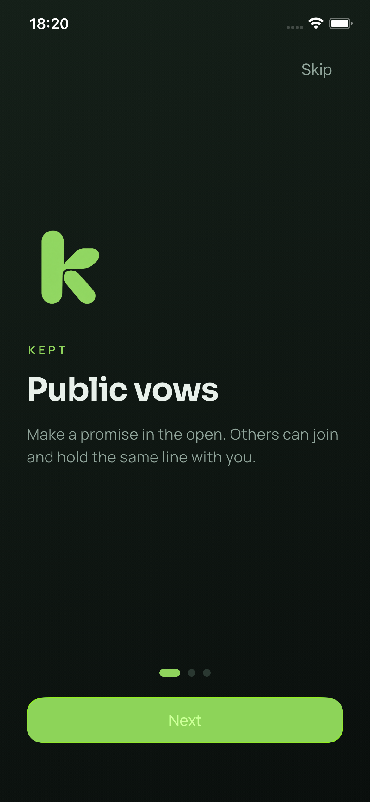
      <br />
      <strong>Public vows</strong>
      <br />
      <sub>A promise made in the open. Other people can join the same line.</sub>
    </td>
    <td align="center" valign="top" width="33%">
      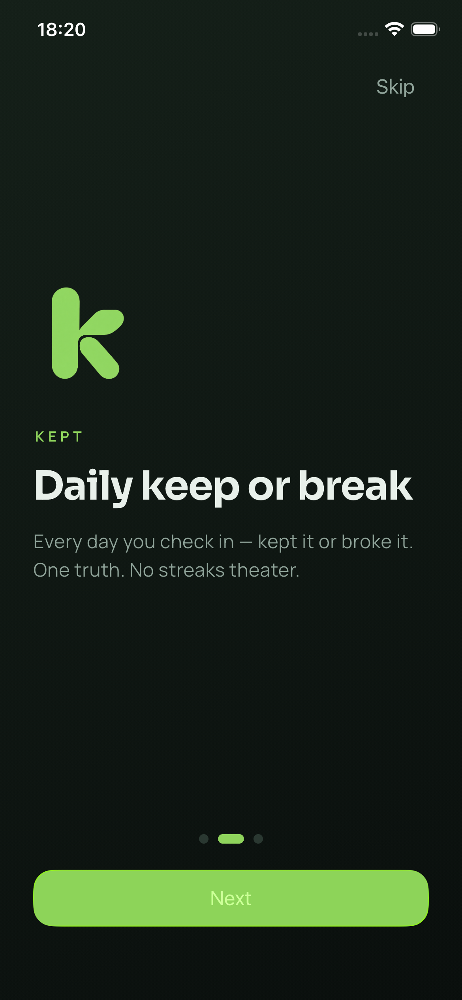
      <br />
      <strong>Daily keep or break</strong>
      <br />
      <sub>One answer a day. Kept it, or broke it.</sub>
    </td>
    <td align="center" valign="top" width="33%">
      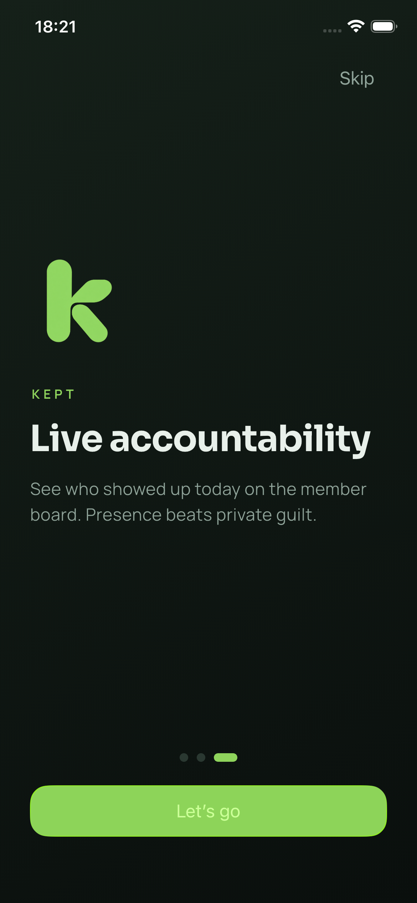
      <br />
      <strong>Live accountability</strong>
      <br />
      <sub>The member board shows who showed up today.</sub>
    </td>
  </tr>
</table>

#### Home

<table>
  <tr>
    <td align="center" valign="top" width="50%">
      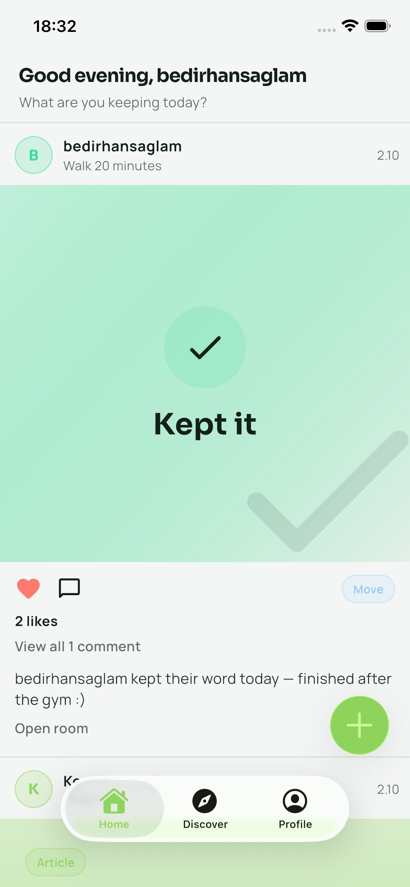
      <br />
      <strong>Light</strong>
      <br />
      <sub>The day opens on your card. This one is already kept. The room is one tap away.</sub>
    </td>
    <td align="center" valign="top" width="50%">
      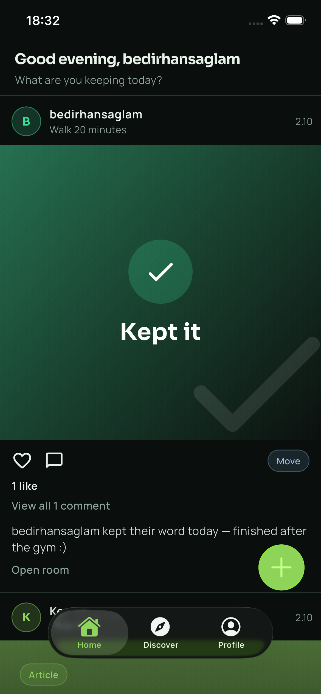
      <br />
      <strong>Dark</strong>
      <br />
      <sub>The same day. Light and dark both live on Profile.</sub>
    </td>
  </tr>
</table>

#### A vow to join, or one you write

<table>
  <tr>
    <td align="center" valign="top" width="33%">
      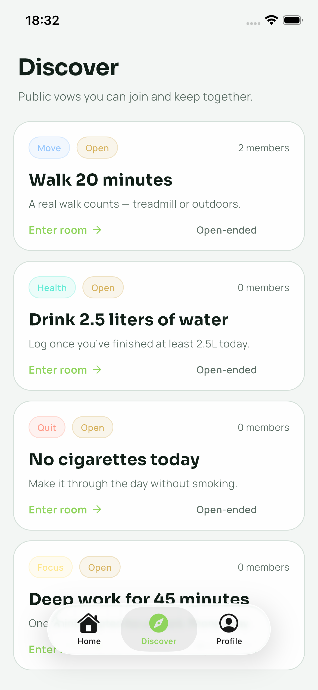
      <br />
      <strong>Discover</strong>
      <br />
      <sub>Public rooms already open: a walk, water, no cigarettes, deep work.</sub>
    </td>
    <td align="center" valign="top" width="33%">
      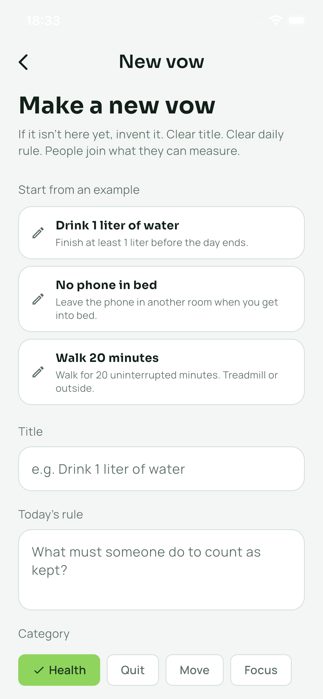
      <br />
      <strong>New vow</strong>
      <br />
      <sub>Start from an example, or write a title and a rule someone else can measure.</sub>
    </td>
    <td align="center" valign="top" width="33%">
      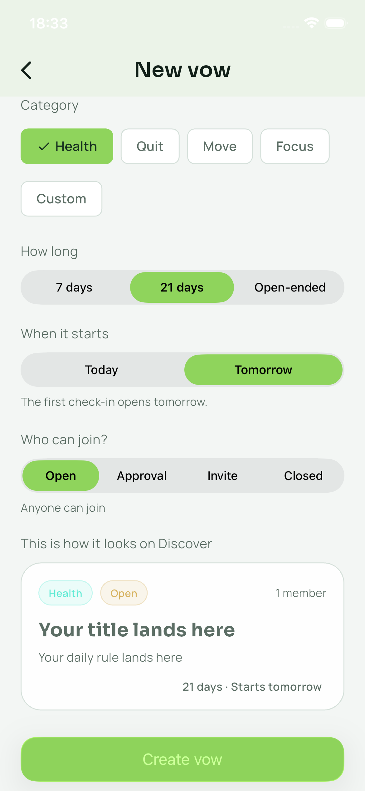
      <br />
      <strong>Before it goes live</strong>
      <br />
      <sub>Length, start day, who can join, and the card Discover will show.</sub>
    </td>
  </tr>
</table>

#### The room

This is the product. The board is a Serverpod stream: a second person checks in, and the count, the percent, and the name move without a reload.

<table>
  <tr>
    <td align="center" valign="top" width="50%">
      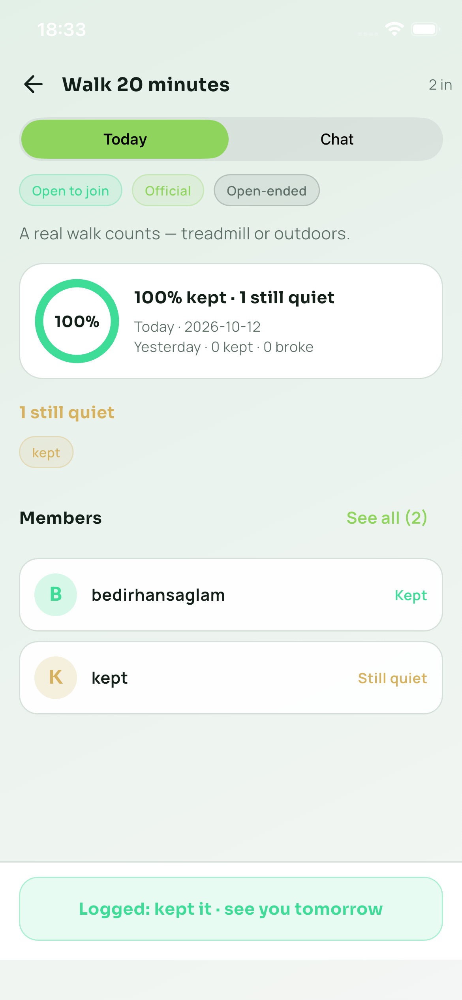
      <br />
      <strong>Today</strong>
      <br />
      <sub>Who kept it, who is still quiet, and that you already answered. Yesterday stays on the board.</sub>
    </td>
    <td align="center" valign="top" width="50%">
      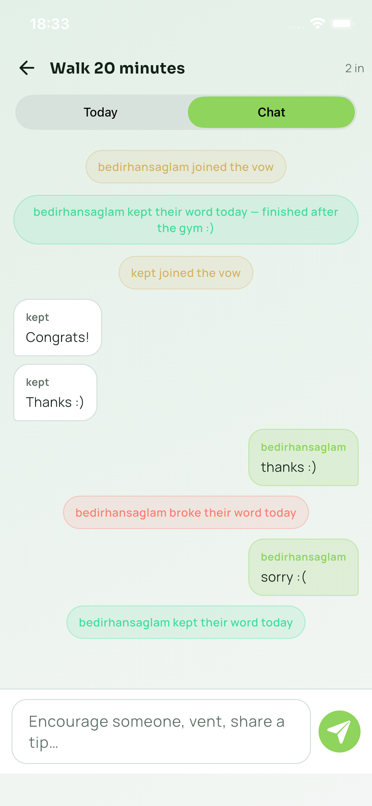
      <br />
      <strong>Chat</strong>
      <br />
      <sub>Joins, keeps, and breaks land in the thread next to what people actually say.</sub>
    </td>
  </tr>
</table>

#### Around the card

<table>
  <tr>
    <td align="center" valign="top" width="50%">
      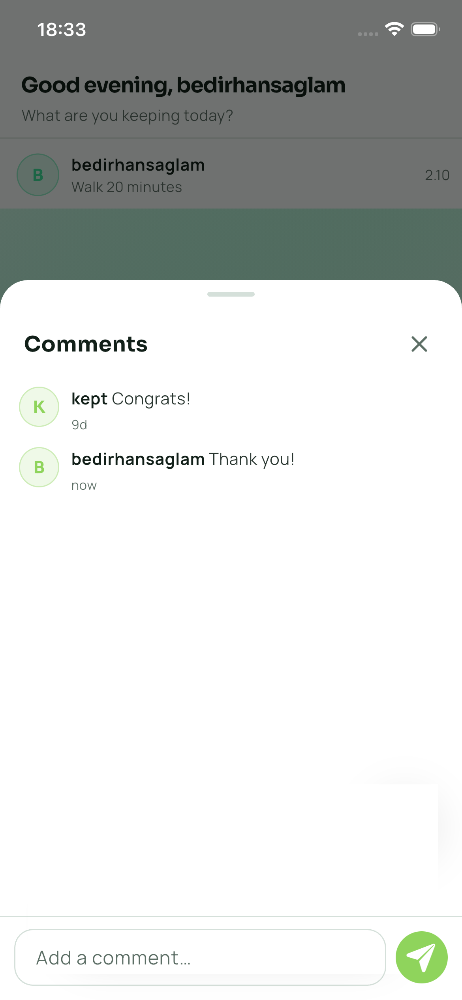
      <br />
      <strong>Comments</strong>
      <br />
      <sub>A note on today's card. The check-in itself stays on the room board.</sub>
    </td>
    <td align="center" valign="top" width="50%">
      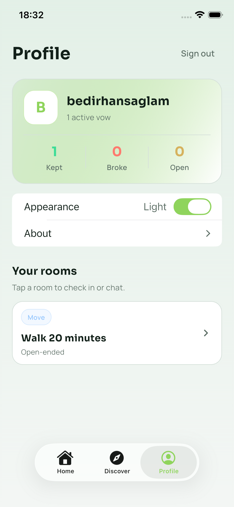
      <br />
      <strong>Profile</strong>
      <br />
      <sub>Kept, broke, still open. Your rooms, and the appearance switch.</sub>
    </td>
  </tr>
</table>

#### Journal

<table>
  <tr>
    <td align="center">
      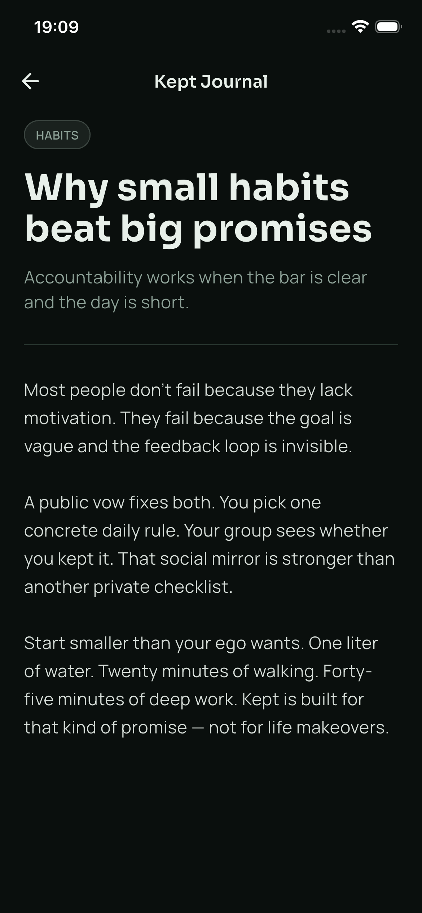
      <br />
      <strong>Kept Journal</strong>
      <br />
      <sub>The Habits card on Home opens here. One concrete daily rule, written out.</sub>
    </td>
  </tr>
</table>

#### Sign in

Serverpod email auth. The verification code arrives in that inbox.

<table>
  <tr>
    <td align="center" valign="top" width="50%">
      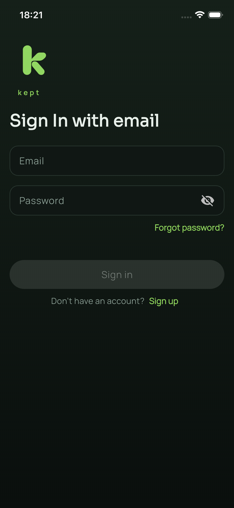
      <br />
      <strong>Sign in</strong>
    </td>
    <td align="center" valign="top" width="50%">
      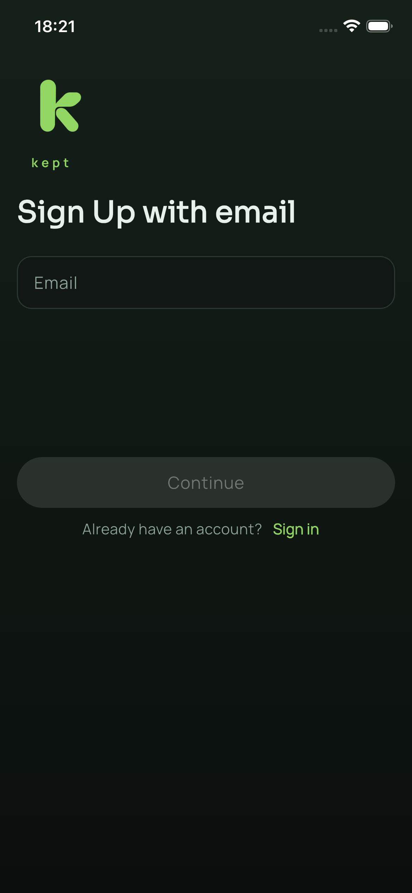
      <br />
      <strong>Sign up</strong>
    </td>
  </tr>
</table>

### Web

Sidebar, the day in the center, Discover as a grid.

<table>
  <tr>
    <td align="center" valign="top" width="50%">
      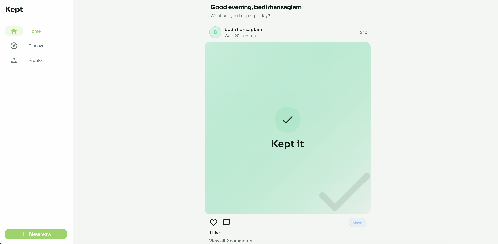
      <br />
      <strong>Home, light</strong>
      <br />
      <sub>Today's card in the center. New vow stays in the sidebar.</sub>
    </td>
    <td align="center" valign="top" width="50%">
      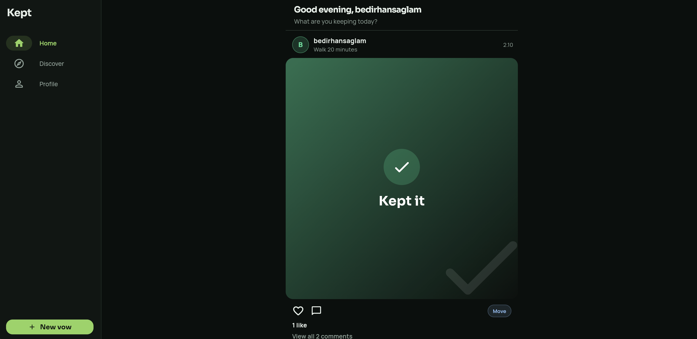
      <br />
      <strong>Home, dark</strong>
      <br />
      <sub>Same layout after dark.</sub>
    </td>
  </tr>
</table>

<p align="center">
  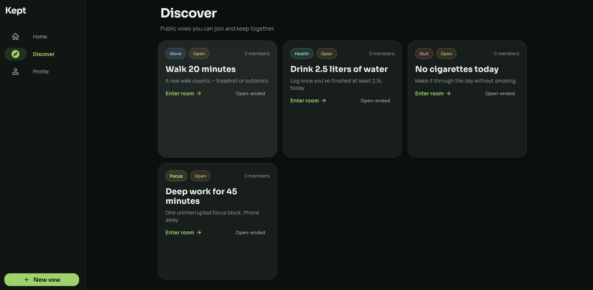
  <br />
  <strong>Discover</strong>
  <br />
  <sub>Public rooms side by side: a walk, water, no cigarettes, deep work.</sub>
</p>

<p align="center">
  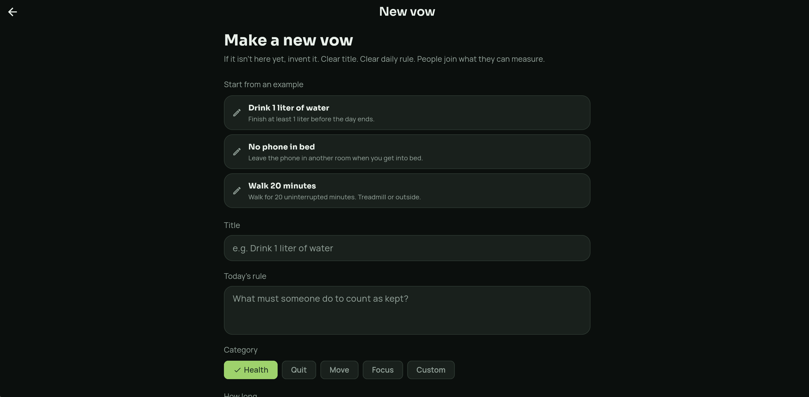
  <br />
  <strong>New vow</strong>
  <br />
  <sub>Start from an example, or write a title and a rule someone else can measure.</sub>
</p>

<p align="center">
  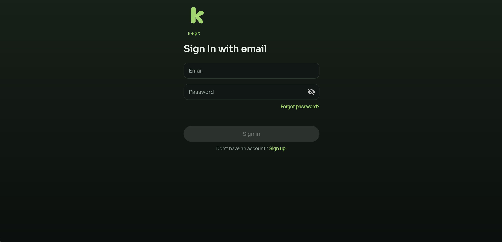
  <br />
  <strong>Sign in</strong>
  <br />
  <sub>Email and password. The same Serverpod auth as on the phone.</sub>
</p>

## Two-minute demo

The screens in **Mobile** and **Web** are this path.

1. Open the live app and look at **Discover**. The first rooms are already there.
2. Create a vow. Pick **21 days** and **Starts tomorrow**, or take one of the examples (a liter of water, no phone in bed, a twenty-minute walk). The card under the form is the room other people will join.
3. Sign in with email. The verification code arrives in that inbox. On a local server with no SMTP configured, the code is printed in the API log instead.
4. Open the room. You are the only name on today’s board.
5. From a second browser, join the same room and press **I kept it**. The first screen moves without a reload: the count, the percent, and the name.
6. Leave the other person quiet. The board still says so. Silence is the point.

The UI is English. Light and dark are both in the profile.

## Run it locally

Serverpod **4.0.3** needs **Flutter 3.44.4+** (Dart **3.12.2+**). 

```bash
git clone https://github.com/flutter/flutter.git -b stable ~/development/flutter
~/development/flutter/bin/flutter upgrade
export PATH="$HOME/development/flutter/bin:$PATH"  
flutter --version   # Flutter 3.44.4+ / Dart 3.12.2+
dart install serverpod_cli
# macOS: put the CLI on PATH
export PATH="$HOME/Library/Application Support/Dart/install/bin:$PATH"
serverpod version   # 4.0.3
```

The scripts prefer `~/development/flutter` when it exists (`KEPT_FLUTTER_ROOT` overrides). 

From the repository root:

| Script | What comes up |
|---|---|
| `./scripts/all.sh` | API, web at http://127.0.0.1:7357, and a simulator if one is already booted |
| `./scripts/backend.sh` | API on port 8080, Insights on 8081, embedded Postgres |
| `./scripts/web.sh` | Flutter web at http://127.0.0.1:7357 (start the API first) |
| `./scripts/mobile.sh` | The booted simulator, talking to localhost |

A phone on the desk cannot use localhost. Give it this computer’s address:

```bash
SERVER_URL=http://<lan-ip>:8080/ ./scripts/mobile.sh <device-id>
```

Point a build at the live API with:

```bash
SERVER_URL=https://kept-vows.api.serverpod.space/ ./scripts/mobile.sh <device-id>
```

The Cloud database and the database inside `serverpod start` are not the same. Rooms you create locally stay on this machine.

## What the product is

Kept is one loop.

- A vow has a title, a daily rule, a category, a length, and a start day.
- Anyone can join an open room. Approval, invite, and closed rooms exist when the vow should stay smaller.
- Each member gets one check-in per local calendar day, not per UTC day. The phone sends its own day.
- The board shows who kept it, who broke it, and who has not spoken. Yesterday stays visible.

The home feed and the room thread sit beside that loop. The thing to watch is the board.

## How it is built

```
kept_server/     Serverpod API, auth, Postgres models, web host
kept_client/     Generated client. Do not edit by hand.
kept_flutter/    The app. Features live under lib/features/<name>/view
scripts/         backend, web, mobile, and all three together
```

```yaml
kept_flutter:
  dependencies:
    cupertino_native: ^0.1.1 # https://github.com/serverpod/cupertino_native
    serverpod_auth_idp_flutter: 4.0.3
    serverpod_flutter: 4.0.3
kept_client:
  dependencies:
    serverpod_auth_idp_client: 4.0.3
    serverpod_client: 4.0.3
kept_server:
  dependencies:
    serverpod: 4.0.3
    serverpod_auth_idp_server: 4.0.3
    serverpod_cloud_storage: 4.0.3
  dev_dependencies:
    serverpod_test: 4.0.3
```

Sign-in, check-in, and the room stream are Serverpod endpoints. `serverpod generate` rewrites `kept_client` after a model or endpoint change. Schema changes go through `serverpod create-migration` inside `kept_server`.

UI copy lives in `kept_flutter/assets/translations/en.json`. Generate keys with:

```bash
cd kept_flutter
dart run easy_localization:generate -S assets/translations -f keys -o locale_keys.g.dart -O lib/product/init/language
dart run easy_localization:generate -S assets/translations -O lib/product/init/language -o codegen_loader.g.dart
```

Use `LocaleKeys.someKey.tr()` (or `.plural(n)`) in Dart. English only for now.

## Deploy

The live project id is `kept-vows`. From `kept_server`, with Flutter 3.44.4+ and Serverpod 4.0.3 on `PATH`:

```bash
scloud deploy
```

Cloud applies migrations and serves the web build. Details: [Serverpod Cloud](https://docs.serverpod.dev/cloud).
